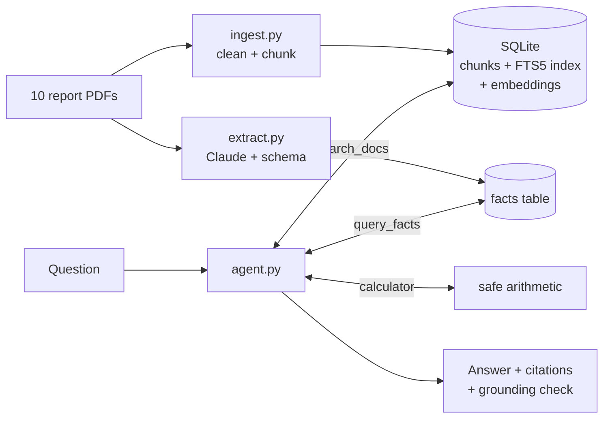

# bigtech-sustainability-qa

[](https://github.com/Mohariz999/bigtech-sustainability-qa/actions/workflows/ci.yml)

Ask questions about Big Tech sustainability reports and get answers you can check. Every answer cites the report and page it came from, and the system says **"not found"** instead of guessing.

It covers 10 reports from Google, Microsoft, Meta, Amazon and Apple (842 pages), and includes a 30-question evaluation that measures every part: search, answers, extraction and agent.

## Why I built this

AI is pushing Big Tech's electricity and water use up fast, and the numbers that show it are spread across long PDF reports. Each company measures things differently, and figures change between editions. I wanted to know whether an LLM system can answer questions about documents like these **reliably**, and to measure that rather than judge it from a demo.

These reports turned out to be a hard test:
- **Key numbers sit in tables**, which become flat rows of numbers when extracted from a PDF.
- **Two editions disagree about the same year**, because companies restate their history.
- **One metric can have two definitions.** Microsoft publishes two different emissions totals using different accounting rules.
- **Questions can have a tempting wrong answer.** "How many data centres does Amazon operate?" isn't answered anywhere, but "AWS constructed 36 data centers with lower-carbon steel" looks like an answer.

## Example

```text
$ python agent.py "How much did Google's data centre electricity use grow from 2024 to 2025?"

  tool: query_facts({"company": "Google", "metric": "datacenter_electricity", "year": "any"})
  tool: calculator({"expression": "(42415800-30637100)/30637100*100"})
  tool: calculator({"expression": "42415800-30637100"})
  tool: calculator({"expression": "(42415800-30825600)/30825600*100"})

[answered] According to Google's 2026 report, its data centre electricity use rose from
30,637,100 MWh in 2024 to 42,415,800 MWh in 2025. That is an increase of 11,778,700 MWh,
or about 38.4%. Google's 2025 report gave a slightly different 2024 figure of 30,825,600 MWh;
measured from that number, the growth would be about 37.6%.

  - google_env_2026 p93: "Data centers MWh 17,429,800 20,616,500 23,980,800 30,637,100 42,415,800"
  - google_env_2025 p107: "Data centers MWh 14,426,600 17,659,000 20,806,200 24,294,900 30,825,600"

3 model calls, $0.0425, 8.9s
```

This is a real run from the evaluation (question q26). The agent looked the numbers up in the extracted facts table, used the calculator instead of doing the maths itself, and noticed on its own that the older report gives a different 2024 figure. The simpler pipeline answered "not found" to the same question.

## Results

Measured on 30 hand-written questions with verified answers, using `claude-opus-5-5`:

| | Correct | Cost per question | Time per question |
|---|---|---|---|
| **Agent** (search + facts table + calculator) | **28/30 (93%)** | 4.6¢ | 7.7s median |
| Pipeline (search → one Claude call) | 20/30 (67%) | 1.7¢ | 4.0s median |

| Component | Result |
|---|---|
| Hybrid search: right page in the top 5 | **73%** (keyword alone 58%, vector alone 62%) |
| Structured extraction | **19/19** hand-checked facts found; 680 facts from 223 pages; 1 clear error in a random sample of 25 |
| "Not found" questions handled correctly | agent 4/4, pipeline 3/4 |
| Made-up numbers caught by the grounding check | 0 |

The agent does best on tables (4/4 vs 2/4) and comparisons (3/3 vs 1/3), at 2.7× the cost. Both of its misses are my grader being too strict: it wrote 33.6% where the answer key expects the text "34%". Full results and failure analysis: **[docs/evaluation.md](docs/evaluation.md)**.

## How it works



1. **Ingest** (`ingest.py`): extract text page by page, strip repeated headers and footers, split into 200-word chunks that never cross a page (so every chunk has exactly one page to cite), and store them in SQLite with a keyword index and an embedding each.
2. **Search** (`search.py`): keyword search (FTS5/BM25) and vector search (`bge-small-en-v1.5`, runs locally), merged with Reciprocal Rank Fusion. Company and year filters run in SQL first.
3. **Answer** (`answer.py`): the top 5 passages go to Claude with strict rules. The reply must match a JSON schema and is validated with Pydantic.
4. **Extract** (`extract.py`): Claude pulls 13 metrics (PUE, electricity, emissions by scope, water, renewables…) from 223 data-heavy pages into a `facts` table. Every fact must quote its page, and the code checks the quote is really there before storing it.
5. **Agent** (`agent.py`): Claude with three tools, in a hand-written loop capped at 8 model calls.

## Design decisions

- **The model never writes a source.** It cites passage or fact IDs, and the code maps them to report and page, so a citation can't be invented.
- **Every answer is checked after it's written.** Quotes must appear in the cited source, and every number must appear in a source (rounding allowed). Anything else is flagged.
- **Narrow tools.** `query_facts` takes company, metric and year, not raw SQL. The calculator parses arithmetic itself instead of calling `eval()`.
- **Evaluation first.** The 30 questions were written and verified against the PDFs before the pipeline existed, and a script re-checks them on every change (`eval/check_questions.py`).
- **Cost is visible.** Tokens, dollars and latency are logged for every call, and `--dry-run` estimates a run before spending anything.
- **Tests are free.** 31 unit tests use a fake Claude client and an in-memory database, so CI needs no API key.

## What went wrong (and what I learned)

The full log is in **[docs/engineering-log.md](docs/engineering-log.md)**. Some highlights:

- **My cleanup step was deleting data.** Removing repeated page headers also removed rows of table numbers, because they look identical once digits are normalised. Fixing it took search from 50% to 73%.
- **The model was right and my answer key was wrong.** Microsoft publishes two FY25 emissions totals under different accounting rules, and my key only knew one.
- **One prompt line cut rejected facts from 6 in 38 to 5 in 685.** The model was shortening quotes with "...", so they failed the "quote is on the page" check.
- **The search score can't tell "found" from "not found".** Not-found questions score as high as answerable ones, so that decision has to come from the model reading the passages.
- **Exact-string grading is too strict for free-text answers.** 33.6% vs "34%" counted as wrong.

## Limitations and next steps

- Normalise units in the facts table (MWh vs TWh, m³ vs million m³), and add a field for site-level vs company-level figures.
- Replace exact-string grading with a number-aware check or an LLM judge, and spot-check the judge too.
- Route simple questions to the cheaper pipeline and comparisons to the agent.
- A small web API and page, deployed with CI/CD.

## Run it yourself

```bash
python3 -m venv .venv && .venv/bin/pip install -r requirements.txt
```

```bash
.venv/bin/python fetch_docs.py
```

```bash
.venv/bin/python ingest.py
```

```bash
.venv/bin/python search.py "What was Google's PUE in 2025?"
```

`fetch_docs.py` downloads the 10 public reports into `data/reports/` (they're not redistributed here). `ingest.py` builds the search index in about 2.5 minutes. Search runs locally and needs no API key.

For the Claude parts, copy `.env.example` to `.env` and add an Anthropic API key:

```bash
.venv/bin/python extract.py --dry-run
```

```bash
.venv/bin/python agent.py "How much did Google's data centre electricity use grow from 2024 to 2025?"
```

```bash
.venv/bin/python eval/run_answers.py --dry-run
```

Rough costs: extraction about $4 (once), a full agent eval about $1.40, a pipeline eval about $0.50. `extract.py --dry-run` and `eval/run_answers.py --dry-run` print estimates for extraction and the pipeline before spending anything.

```bash
.venv/bin/python -m pytest -q
```

## Project layout

```text
fetch_docs.py      download the reports, write data/reports/manifest.csv
ingest.py          PDF → cleaned chunks → SQLite (keyword index + embeddings)
search.py          keyword, vector and hybrid search with filters
answer.py          pipeline: search → Claude → validated, grounded answer
extract.py         structured extraction into the facts table
agent.py           tool-calling agent: search_docs, query_facts, calculator
eval/              questions, gold facts, scoring scripts, results
logs/              every model call from the evaluation runs
tests/             unit tests with a fake Claude client
docs/              evaluation results, engineering log, corpus notes
```

## Licence

[MIT](LICENSE). The reports themselves belong to their publishers and are downloaded from their public URLs, not included here.
