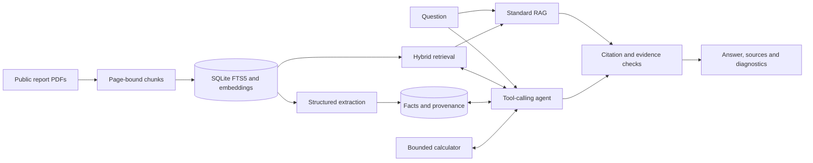

# Big Tech Sustainability Q&A

Ask questions about sustainability reports from Google, Microsoft, Meta, Amazon and
Apple, and inspect the report page and quotation behind each answer. The corpus
contains 10 public reports (842 pages). Tables, restated figures and competing
accounting definitions make this a useful test of retrieval and numerical reasoning.

- **Standard RAG pipeline.** Retrieve five passages with hybrid search and ask Claude
  for a structured answer with citations.
- **Tool-calling agent.** Let Claude search passages, look up structured facts and
  calculate comparisons within explicit tool and context limits.
- **Inspectable evidence.** Keep source quotations and original extracted values.
  Report citation and numerical diagnostics alongside the answer or `not_found` status.

## Architecture



Python 3.12/3.13, PyMuPDF, SQLite FTS5/BM25, FastEmbed with local BGE small
embeddings, NumPy, Pydantic and the Anthropic SDK (pinned to 1.15.0).
See [architecture and trade-offs](docs/architecture.md).

## Installation and configuration

Run these commands in a POSIX shell. Use `python3.13` if that is your installed
version. Installation needs package downloads. Direct dependencies are pinned.

```bash
git clone https://github.com/Mohariz999/bigtech-sustainability-qa.git
cd bigtech-sustainability-qa
python3.12 -m venv .venv
.venv/bin/python -m pip install -r requirements-dev.txt
```

### Build a local index

Use a fresh checkout or back up `data/corpus.sqlite` first. **Ingestion replaces the
database, including existing facts.** The report PDFs and the first embedding model
download require internet access. Local indexing and search use no paid model API.

```bash
.venv/bin/python fetch_docs.py
.venv/bin/python ingest.py
.venv/bin/python search.py "What was Google's PUE in 2025?"
```

To enable fact lookup, restore the saved snapshot without paid extraction.
Import requires an empty facts table. Restored fact IDs may differ from old logs.

```bash
.venv/bin/python -c 'import sqlite3; from extract import FACTS_SCHEMA; db=sqlite3.connect("data/corpus.sqlite"); db.executescript(FACTS_SCHEMA); db.close()'
.venv/bin/python fact_quality.py data/corpus.sqlite --import-csv eval/results/facts.csv > fact-quality-report.json
```

See [corpus sources](docs/corpus.md) and [fact quality and migration](docs/fact-quality.md).

## Ask a question

These commands **use paid Claude credits**. Set `ANTHROPIC_API_KEY` in the environment
or copy `.env.example` to `.env` and fill it locally. Keep credentials out of Git.

```bash
.venv/bin/python answer.py "What was Google's PUE in 2025?"
.venv/bin/python agent.py "How much did Google's data centre electricity use grow from 2024 to 2025?"
```

For the second question, the saved final agent answer cites Google's 2026 report
and calculates 38.4% growth using figures from that edition. It also gives 37.6%
using the older 2024 figure. The strict answer key expects 38 or 37, so the grader
marks that answer incorrect. See the [q26 analysis](docs/benchmark-2026-11-09.md#remaining-failures-and-rubric-limitations).

## Evaluation methodology

The matched live comparison used the same [30 development questions](eval/questions.jsonl),
corpus, local embedding snapshot, Claude Opus 5.5 configuration and SDK for both
commits. One frozen `deterministic-v2` grader scored all 120 answers offline. It
checks structured abstention for unanswerable questions and answer status plus
required values or phrases for answerable ones. Numeric boundaries and explicit
unit checks apply where the key supplies units. Default numeric tolerances are zero.
See the [grading criteria](docs/evidence-and-evaluation.md#grading-versions).

## Current benchmark · 9 November 2026

| System | Baseline `0aeb778` | Final `fc2031b` |
|---|---:|---:|
| Standard RAG | 66.7% (20/30) | 70.0% (21/30) |
| AI agent | 83.3% (25/30) | 86.7% (26/30) |

Both gains came solely from q28 changing its structured status to `not_found`.
The answer text still discusses a related Google projection. These observations
cannot isolate the effect of individual engineering changes on semantic accuracy.

| Run | Input / output tokens | Total USD | Median model API / application time |
|---|---:|---:|---:|
| Baseline RAG | 85,416 / 8,617 | $0.514004 | 3.65 / 3.68 s |
| Final RAG | 85,416 / 8,460 | $0.510864 | 3.29 / 3.33 s |
| Baseline agent | 236,648 / 15,632 | $1.259232 | 7.12 / 7.17 s |
| Final agent | 291,448 / 16,422 | $1.494232 | 6.56 / 6.60 s |

The four runs cost **$3.778332** based on API usage, with 211 model calls, zero
cache tokens and zero run errors. Application times exclude free budget token
counting. Agent cost rose 18.7% and its gold-page citation overlap fell from 23/26
to 22/26. Latencies describe this single trial. See the
[full report and per-question failures](docs/benchmark-2026-11-09.md) and
[saved verdicts and metrics](eval/results/benchmark-2026-11-09/).

The earlier 90% agent and 63% pipeline scores used legacy substring grading.
Compare results within each rubric. See [historical evaluation](docs/evaluation.md).

## Engineering decisions and limitations

- **Hybrid search** combines exact terms and semantic matches using Reciprocal Rank
  Fusion. The vector scan fits this corpus. Page boundaries can split tables and
  document-year filters can miss historical values in later editions.
- **Facts retain source context.** Derived unit, scope, period and basis metadata
  preserve raw observations. Ambiguous fields remain unresolved, and short quotes
  can lack table headers.
- **Tools have narrow interfaces.** The agent uses parameterized lookups and a
  bounded arithmetic parser. Citation checks and source screening catch selected
  problems. Semantic support and resistance to prompt injection require separate
  evaluation. See [security boundaries](SECURITY.md).
- **Evaluation is limited to a small development set.** Rounding, ambiguous metric
  definitions and report editions affect the grades. The prototype runs locally
  and has no hosted serving layer or held-out enterprise benchmark.

## Testing and reproducibility

Run from the repository root. These checks require no API key, PDFs, database or
embedding download. GitHub Actions runs them on Python 3.12 and 3.13.

```bash
.venv/bin/python -m pip check
.venv/bin/python -m ruff check .
.venv/bin/python -m pytest -q
.venv/bin/python -m eval.verify_benchmark
```

The verifier checks all published verdicts and reconciles the reported costs
against aggregate token usage. See [contributor instructions](CONTRIBUTING.md),
[offline rescoring and the live comparison protocol](docs/evidence-and-evaluation.md)
and the [engineering log](docs/engineering-log.md).

[MIT license](LICENSE). The source reports remain with their publishers and are
downloaded separately.
