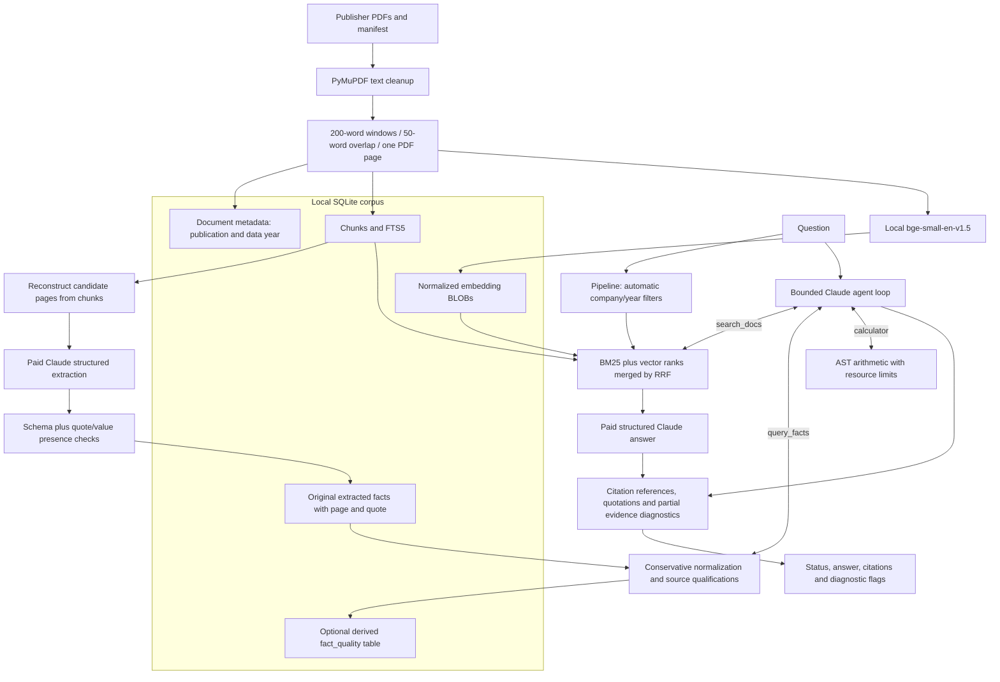

# Architecture and engineering trade-offs

The system combines cited text retrieval with structured numerical observations.
It is a local application prototype over public PDFs; deployment, authentication,
multi-tenant isolation and a web API are not implemented.

## Data and provenance

`fetch_docs.py` stores URLs, byte counts and status in a manifest. PDF page numbers
are 1-based indices, not printed page labels. `ingest.py` stores cleaned text and
never joins chunks across pages. Extraction reconstructs pages from those chunks;
it does not re-read PDF layout. Tables can therefore lose header/column associations.

Facts keep the original company, document, page, metric, value, unit, period,
accounting basis and quotation. `fact_quality.py` adds conservative derived metadata
without rewriting raw rows. Scope can remain unknown, ambiguous units unresolved,
and attribution unreviewed. The optional table is a cache of derived metadata;
agent lookup also derives it on read, so a legacy read-only database still works.
Raw-row fingerprints are not content hashes of the source PDFs.

Publication year and a fact's reporting period differ. Document-level search filters
use the document's main data year; historical observations inside other editions
can still be missed. Fact lookup matches its own period and qualifies fiscal,
calendar and cumulative observations. A different edition or accounting basis is
retained, not silently merged or selected as the only truth.

## Retrieval and generation

SQLite FTS5/BM25 is useful for exact terms; local embeddings supply semantic matches.
Each retrieval branch contributes a 30-candidate pool to RRF (constant 60), with
five final passages by default. Filters precede truncation. Vector similarity scans
a matrix loaded into memory; no approximate nearest-neighbor service is used.
This favors inspectability at this scale over distributed serving.

The pipeline retrieves then requests one structured answer, with one schema retry.
The handwritten agent chooses among narrow search, fact lookup and calculator
tools. Strict hosted schemas are backed by local argument validation. Expected
storage/retrieval errors are returned as tool errors; model steps, tools, identical
calls, result characters and conversation characters have separate limits.
SDK retries are not additional loop steps and can affect actual attempts/latency.

The model selects source IDs, and code maps them to observed documents/pages.
Invalid or empty quotations cannot supply numeric evidence. Checks recognize some
unit/sign/period/company/metric contradictions, but matching a number or a quote is
not semantic entailment. Diagnostic flags do not automatically suppress the answer.

## Operations and evaluation

Tests use fake clients, temporary databases and blocked sockets. Paid model calls
are absent from CI. Recorded model-call latency and new end-to-end timing are
separate. New evaluation runs use unique directories with code/dataset/config
manifests; saved historical outputs remain unchanged.

Versioned grading separates legacy substring scores from numeric-boundary/unit
checks. Neither grader can fully judge natural-language meaning. No runtime prompt
or retrieval module loads gold questions/answers; the fixed set is used by evaluation
scripts and has also been used during development.

Direct Python dependencies and CI action commits are pinned. Transitive packages
and source PDFs are not fully locked, and embedding identity is not enforced by the
index schema. Controlled benchmarks need frozen corpus/model/config artifacts.

`ingest.py` still deletes an existing database before rebuilding, including facts.
`extract.py` now refuses populated facts and publishes only complete successful
runs into an empty store. Download validation and atomic ingestion are known
limitations, not solved by CI or the fact metadata migration.
